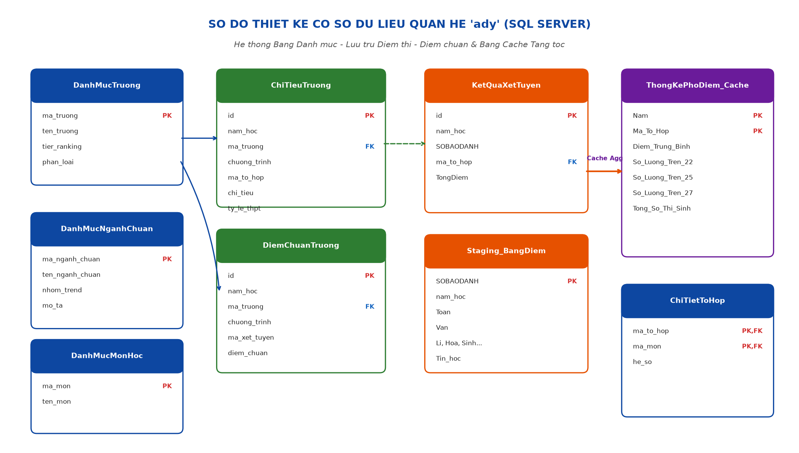
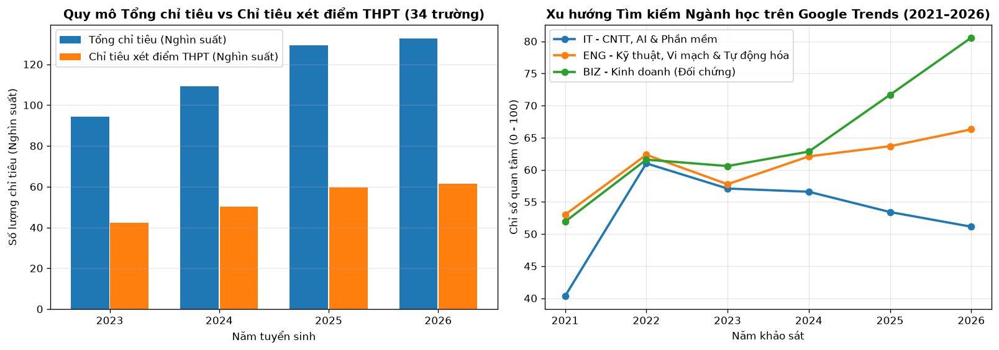
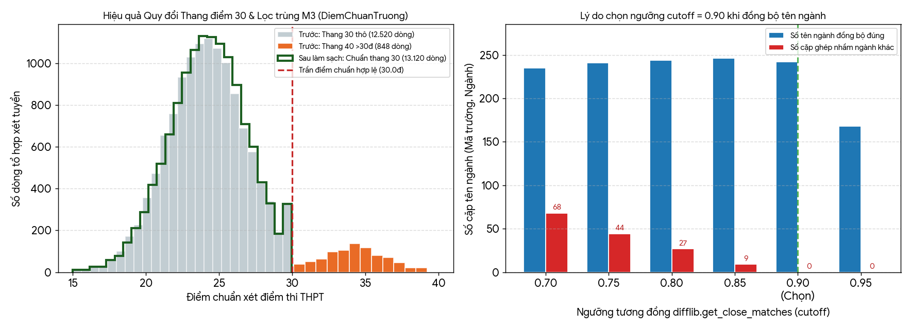
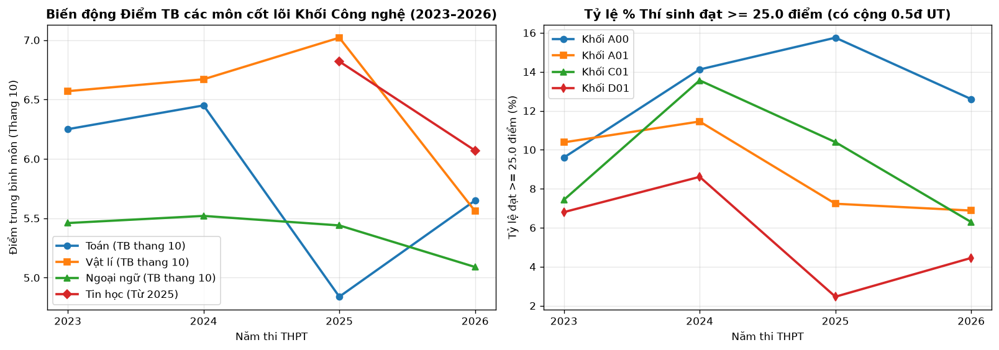
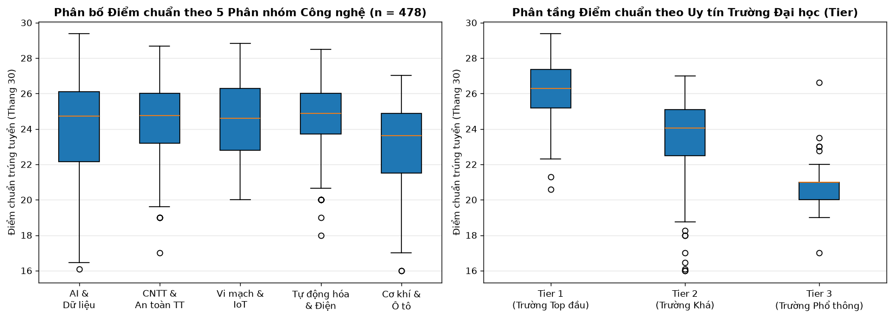
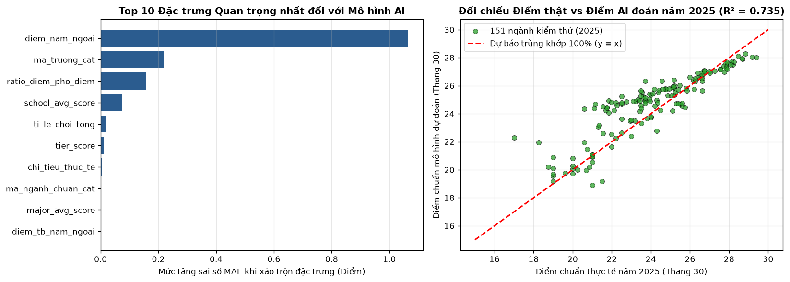
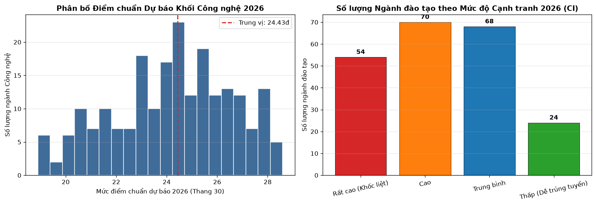

# BÁO CÁO ĐỒ ÁN MÔN HỌC: PHÂN TÍCH DỮ LIỆU NÂNG CAO (ADY201m)

**Đề tài:** NGHIÊN CỨU PHÂN TÍCH MỨC ĐỘ CẠNH TRANH VÀ DỰ BÁO ĐIỂM CHUẨN ĐẠI HỌC KHỐI NGÀNH CÔNG NGHỆ – KỸ THUẬT TẠI KHU VỰC HÀ NỘI GIAI ĐOẠN 2023–2026

**Quy trình:** Kho CSDL SQL Server 12 bảng → Kiểm toán 6 chiều DAMA UK → Làm sạch & Đồng bộ difflib → 16 Đặc trưng chống rò rỉ → Mô hình kép HistGradientBoostingRegressor (Direct + Delta) → Web App Streamlit (`app.py`)

**Đơn vị:** Khoa Công nghệ Thông tin & Khoa học Dữ liệu | Hà Nội, 2026
---

## TÓM TẮT ĐỒ ÁN (EXECUTIVE SUMMARY)

Trong bối cảnh kỳ thi tốt nghiệp Trung học Phổ thông (THPT) tại Việt Nam bước vào giai đoạn chuyển giao mang tính bước ngoặt từ năm 2025 theo Chương trình Giáo dục Phổ thông 2018 (giảm số môn bắt buộc xuống 4 môn, xuất hiện môn thi Tin học và các tổ hợp mới X06, X26), việc xác định điểm chuẩn và đo lường áp lực cạnh tranh xét tuyển vào khối ngành Công nghệ – Kỹ thuật tại khu vực Hà Nội trở thành một bài toán đặc biệt phức tạp, cấp thiết và tiềm ẩn rủi ro lớn đối với thí sinh, phụ huynh cũng như các cơ sở đào tạo.

Đồ án này xây dựng một hệ thống Khoa học Dữ liệu thực chiến khép kín (End-to-End Data Science Pipeline) bao gồm 6 giai đoạn kỹ thuật liền mạch: từ thiết kế kho dữ liệu quan hệ SQL Server `ady` (12 bảng) tiếp nhận hơn 4,29 triệu bản ghi thí sinh; cào tự động 13.368 dòng điểm chuẩn và 3.360 dòng chỉ tiêu; làm sạch 2 tầng (khử trùng, quy đổi thang 40 về 30, so khớp tên ngành bằng `difflib` cutoff 0.90); chế biến 16 đặc trưng chống rò rỉ thông tin tương lai; đến huấn luyện kiến trúc Học máy 3 Nhóm Chuyên gia AI kết hợp kỹ thuật pha trộn kép (`Direct + Delta`) bằng thuật toán `HistGradientBoostingRegressor`; và triển khai ứng dụng Web Dashboard tư vấn trực quan bằng Streamlit (`app.py`).

| Chỉ số / Hạng mục | Kết quả Định lượng Thực tế của Đồ án |
| --- | --- |
| Quy mô dữ liệu xử lý | 4.292.528 bản ghi thí sinh THPT (2023–2026), 13.120 dòng điểm chuẩn sạch, 3.360 dòng chỉ tiêu, 36 trường ĐH. |
| Hạ tầng CSDL & Xử lý | Microsoft SQL Server 2022 (CSDL ady gồm 12 bảng chính thức), bảng Cache ThongKePhoDiem_Cache truy vấn tức thời. |
| Tập mẫu Huấn luyện/Kiểm thử | 478 chương trình Công nghệ: Tập Học (2023–2024: 262 dòng), Tập Kiểm Thử (2025: 151 dòng), 65 ngành mới mở. |
| Bộ đặc trưng đầu vào | 16 biến đặc trưng tuyển sinh chuẩn hóa (đã loại bỏ 17 cột thô, cờ nhãn rò rỉ và số đếm tuyệt đối lệch quy mô). |
| Độ chính xác mô hình AI đề xuất | HistGradientBoosting Kép (3 Nhóm Chuyên gia): R² = 0.7352, MAE = 1.0196 điểm, MedAE = 0.7223 điểm, RMSE = 1.3796 điểm. |
| Mô hình đối chứng cơ sở (Baseline) | Linear Regression: R² = -25.1010, MAE = 10.9821 điểm (thất bại do đa cộng tuyến và quan hệ phi tuyến trần 30đ). |
| Chỉ số Cạnh tranh Đa biến (CI) | Chỉ số tổng hợp 4 thành phần (Điểm chuẩn, Tỷ lệ chọi logarit, Hạng Tier trường, Google Trends) thang 0–100. |
| Phân tầng Cạnh tranh 2026 (216 ngành) | Rất cao (CI ≥ 72): 54 ngành (25.0%) | Cao (60–72): 70 ngành (32.4%) | Trung bình (48–60): 68 ngành (31.5%) | Thấp (< 48): 24 ngành (11.1%). |
| Sản phẩm ứng dụng đầu cuối | Web App Streamlit (app.py + run.bat) chạy Offline 100%, phân 3 Tab Nguyện vọng (An Toàn, Vừa Sức, Thử Thách). |

# CHƯƠNG I: TỔNG QUAN ĐỀ TÀI, HIỂU BÀI TOÁN VÀ PHƯƠNG PHÁP TIẾP CẬN

## 1.1. Bối cảnh Thực tiễn và Tính Cấp thiết của Đề tài

Tại Việt Nam, kết quả kỳ thi tốt nghiệp THPT giữ vai trò trung tâm trong công tác tuyển sinh đại học hàng năm. Khu vực Hà Nội tập trung mật độ cao nhất các trường đại học đào tạo công nghệ đầu ngành của cả nước (ĐH Bách khoa Hà Nội, ĐH Công nghệ - ĐHQGHN, Học viện Bưu chính Viễn thông...). Tuy nhiên, bước sang năm 2025 và 2026, công tác xét tuyển đối mặt với biến động dữ liệu chưa từng có tiền lệ do triển khai quy chế thi mới:

- **Cơ cấu môn thi thay đổi căn bản:** Thí sinh chỉ còn thi 4 môn (2 môn bắt buộc: Toán, Ngữ văn; 2 môn tự chọn), khiến cơ cấu thí sinh theo từng khối truyền thống (A00, A01, D01) sụt giảm mạnh từ 40% đến 50% quy mô tuyệt đối.
- **Sự xuất hiện của môn Tin học và tổ hợp mới:** Môn Tin học lần đầu tiên được đưa vào kỳ thi tốt nghiệp THPT, hình thành các tổ hợp tuyển sinh kỹ thuật mới như X06 (Toán, Lý, Tin), X26 (Toán, Anh, Tin), cạnh tranh trực tiếp nguồn tuyển với khối A00 và A01.
- **Thu hẹp chỉ tiêu phương thức thi THPT:** Các trường đại học gia tăng tỷ lệ xét tuyển sớm (học bạ, HSA, TSA), khiến quỹ chỉ tiêu dành riêng cho phương thức xét điểm thi THPT bị thu hẹp chỉ còn từ 40% đến 50%, đẩy áp lực cạnh tranh thực tế lên mức cao kỷ lục.

## 1.2. Định nghĩa 'Nỗi Đau' Tuyển sinh và Lượng hóa Giá trị Kinh tế / Tiết kiệm Chi phí

Trong khoa học dữ liệu ứng dụng, một dự án đạt chuẩn phải xuất phát từ bài toán thực tế và chứng minh được giá trị định lượng mang lại. Đề tài tiếp cận bài toán tuyển sinh dưới hai góc nhìn kinh tế - xã hội rõ ràng:

## 1.3. Mục tiêu Nghiên cứu và Ba Câu hỏi Nghiên cứu Cốt lõi (RQ)

| Mã RQ | Nội dung Câu hỏi Nghiên cứu Cốt lõi |
| --- | --- |
| RQ1: Chi phối | Trong các yếu tố: Điểm chuẩn năm ngoái, biến động đề thi THPT, chỉ tiêu xét tuyển, tỷ lệ chọi và thứ hạng uy tín trường, yếu tố nào chi phối mạnh nhất đến điểm chuẩn và mức độ cạnh tranh khối Công nghệ? |
| RQ2: Độ chính xác | Có thể xây dựng mô hình Học máy dự báo điểm chuẩn THPT thang 30 cho 216 chương trình Công nghệ với sai số MAE dưới 1.10 điểm và hệ số xác định R² trên 70% trên tập kiểm thử độc lập hay không? |
| RQ3: Kiến trúc | Kiến trúc mô hình chia 3 Nhóm Chuyên gia AI kết hợp phương pháp pha trộn kép (Direct + Delta) có vượt trội hơn mô hình Hồi quy tuyến tính nền (Linear Regression) và Cây quyết định đơn (Decision Tree) hay không? |

## 1.4. Thiết lập Bài toán trong Khoa học Dữ liệu (Problem Formulation)

## 1.5. Lộ trình Kiến trúc Kỹ thuật 6 Giai đoạn

| Giai đoạn | Hạng mục Kỹ thuật | Tệp Mã nguồn Tương ứng | Đầu ra Định lượng |
| --- | --- | --- | --- |
| Giai đoạn 1 | Kho CSDL & Phổ điểm THPT | schema.sql, Procedures.sql, 1_import_data_to_sql.py, run_data.sql | Khởi tạo 12 bảng CSDL ady, nạp 4.292.528 thí sinh, tính bảng Cache ThongKePhoDiem_Cache. |
| Giai đoạn 2 | Thu thập Điểm chuẩn & Chỉ tiêu | 2_scrape_diemchuan.py, 3_scrape_chitieu.py | Nạp 13.368 dòng điểm chuẩn (API Tuyensinh247) và 3.360 dòng chỉ tiêu, kiểm toán DAMA UK. |
| Giai đoạn 3 | Làm sạch & Đồng bộ trên SQL | 4_data_cleaning.py, Procedures.sql | Quy đổi thang 30, xóa cơ sở Nam, đồng bộ khối Tin X06/X26, khớp difflib ≥ 90% (13.120 dòng sạch). |
| Giai đoạn 4 | Chế biến Đặc trưng & Lọc phạm vi | src/data_processing.py | Lọc 5 phân nhóm Công nghệ (478 dòng), chế biến 16 đặc trưng chống rò rỉ, chia Train/Test. |
| Giai đoạn 5 | Huấn luyện AI & Dự báo 2026 | src/model_training.py, src/prediction.py, 5_train_model.py | Huấn luyện 3 Nhóm Chuyên gia HGB kép (Direct+Delta), tính chỉ số CI và xuất predictions_2026.csv. |
| Giai đoạn 6 | Web Dashboard & Tư vấn | app.py, run.bat | Xây dựng Web Streamlit 3 Tab Nguyện vọng, tra cứu toàn cảnh 9 cột, chạy offline 100%. |

## 1.6. Phạm vi Nghiên cứu và Nguyên tắc Chống Rò rỉ Dữ liệu (Data Leakage)

# CHƯƠNG II: THU THẬP, KHÁM PHÁ VÀ KIỂM TOÁN CHẤT LƯỢNG DỮ LIỆU

## 2.1. Tổng quan 5 Nguồn Dữ liệu Đầu vào của Dự án

| Nguồn Dữ liệu | Tệp Lưu trữ / Phương thức | Quy mô & Ý nghĩa Nghiệp vụ |
| --- | --- | --- |
| 1. Phổ điểm thi THPT | 4 tệp CSV (data_raw/diem_thpt_2023.csv đến 2026.csv) | 4.292.528 dòng (2023: 1.022.060; 2024: 1.061.605; 2025: 1.000.000; 2026: 1.208.863). Phản ánh phía Cung điểm số thí sinh toàn quốc. |
| 2. Lịch sử Điểm chuẩn | API Tuyensinh247 (qua 2_scrape_diemchuan.py) | 13.368 dòng điểm chuẩn giai đoạn 2022–2025 của 34 cơ sở giáo dục đại học tại Hà Nội theo từng tổ hợp. |
| 3. Đề án Tuyển sinh | data_raw/Chỉ tiêu.xlsx (qua 3_scrape_chitieu.py) | 3.360 dòng chỉ tiêu tuyển sinh giai đoạn 2023–2026, tỷ lệ % chỉ tiêu dành riêng cho xét điểm thi THPT. |
| 4. Xếp hạng Trường | data_raw/Tier list.xlsx | 35 dòng (33 trường duy nhất) phân hạng uy tín đào tạo thành Tier 1 (Hạng nhất), Tier 2 (Hạng nhì), Tier 3 (Hạng ba). |
| 5. Xu hướng Ngành | data_raw/trend_nganh_google.csv | 60 dòng khảo sát chỉ số quan tâm tìm kiếm trên Google Trends giai đoạn 2021–2026 cho các nhóm từ khóa công nghệ. |

## 2.2. Thiết kế Kiến trúc Cơ sở Dữ liệu SQL Server 'ady' và Sơ đồ ERD

## 2.3. Khám phá và Kiểm toán Chất lượng Dữ liệu Thô theo Khung DAMA UK

| Chiều Đánh giá DAMA UK | Hiện trạng Ghi nhận trên Dữ liệu Gốc |
| --- | --- |
| 1. Completeness (Tính Đầy đủ) | Chỉ tiêu.xlsx, Tier list.xlsx, Google Trends đạt 100% không khuyết. Riêng DiemChuanTruong có 42 dòng khuyết mã tổ hợp. |
| 2. Uniqueness (Tính Duy nhất) | Phát hiện 284 dòng điểm chuẩn thuộc cơ sở phía Nam / phân hiệu ngoài Hà Nội, 196 dòng trùng khóa tổ hợp và 2 mã trường lặp trong Tier list.xlsx (ANS, HTC). |
| 3. Validity (Tính Hợp lệ) | Phát hiện 848 dòng điểm chuẩn vượt trần 30.0 điểm (chấm theo thang 40 có nhân đôi môn chính), 2 dòng chỉ tiêu ghi khoảng ước lượng chữ (~100-240, ~60-160). |
| 4. Consistency (Tính Nhất quán) | Lệch mã tổ hợp Tin học mới 2025 (các trường dùng A0T, D0T trong khi Bộ GD&ĐT quy chuẩn là X06, X26). Tỷ lệ khớp nguyên văn tên ngành giữa Chỉ tiêu và Điểm chuẩn chỉ đạt 42.35%. |
| 5. Timeliness (Tính Kịp thời) | Độ phủ thời gian đầy đủ 4 năm (2023–2026), đảm bảo tạo đủ biến trễ lịch sử (Lag-1) cho tập Train và dự báo. |
| 6. Accuracy (Tính Chính xác) | Phân phối chỉ tiêu lệch phải rất mạnh (IQR = [60, 154.5], có 274 dòng vượt rào trên 310 suất do tuyển sinh theo nhóm ngành lớn). |

## 2.4. Danh mục 10 Vấn đề Chất lượng Dữ liệu (DQ) và Khảo sát Ngoại lai IQR

| Mã DQ | Chiều DAMA | Bảng dữ liệu | Hiện trạng lỗi phát hiện | Quy tắc Xử lý Bàn giao |
| --- | --- | --- | --- | --- |
| DQ-01 | Validity | DiemChuanTruong | 848 dòng có điểm chuẩn > 30.0đ (thang 40) | Bắt buộc: Quy đổi về thang 30 bằng công thức (diem_chuan / 40.0) * 30.0. |
| DQ-02 | Uniqueness | DiemChuanTruong | 284 dòng cơ sở phía Nam, 196 dòng trùng khóa | Bắt buộc: Dùng câu lệnh DELETE JOIN loại bỏ phân hiệu phía Nam và khử trùng. |
| DQ-03 | Validity | ChiTieuTruong | 2 dòng chỉ tiêu chữ (~100-240, ~60-160) bị ép về 0 | Quyết định: Bóc tách trung bình cộng hai đầu mút khoảng (gán 170 và 110). |
| DQ-04 | Consistency | ThongKePhoDiem_Cache | Thiếu ánh xạ mã tổ hợp Tin học mới (X06, X26) | Bắt buộc: Nhân bản phổ điểm từ mã cũ A0T, D0T sang mã mới X06, X26. |
| DQ-05 | Consistency | DanhMucTruong | Tên trường tạm dạng viết tắt tiếng Anh (Trường BKA) | Quyết định: Ghép nối với Tier list.xlsx xuất ra kết quả school_mapping.json 36 trường. |
| DQ-06 | Uniqueness | Tier list.xlsx | Mã ANS và HTC xuất hiện lặp 2 dòng | Bắt buộc: Dùng drop_duplicates giữ dòng đầu tiên trước khi ghép bảng. |
| DQ-07 | Consistency | ChiTieu & DiemChuan | Tên chương trình viết lệch (khớp trực tiếp chỉ 42.35%) | Quyết định: Dùng thuật toán so khớp chuỗi difflib (cutoff 0.90) nâng độ khớp lên 74.8%. |
| DQ-08 | Completeness | DiemChuanTruong | 42 dòng khuyết mã tổ hợp xét tuyển | Bắt buộc: Loại bỏ các dòng không xác định được tổ hợp xét tuyển. |
| DQ-09 | Accuracy | ChiTieuTruong | Chỉ tiêu phân phối lệch phải (vượt rào IQR > 310) | Quyết định: Giữ nguyên quy mô thật và áp dụng hàm logarit np.log1p khi tạo biến. |
| DQ-10 | Scope | Toàn bộ CSDL | Chứa lẫn các ngành Kinh tế, Y dược, Sư phạm, Luật... | Bắt buộc: Lọc giữ chuyên sâu đúng 5 phân nhóm Công nghệ – Kỹ thuật (478 dòng). |

# CHƯƠNG III: TIỀN XỬ LÝ, TRUY VẤN SQL CHUYÊN SÂU VÀ PHÂN TÍCH KHÁM PHÁ (EDA)

## 3.1. Quy trình Làm sạch 2 Tầng và Đồng bộ Dữ liệu trên SQL Server

## 3.2. Nhật ký Kiểm toán CSDL (SQL Audit Trail)

| Hạng mục Kiểm toán | Bảng SQL Tác động | Trạng thái Trước Làm sạch | Trạng thái Sau Làm sạch |
| --- | --- | --- | --- |
| 1. Khối Tin học mới | ThongKePhoDiem_Cache | 0 dòng khối X06, X26 | Đủ 4 dòng X06, X26 cho năm 2025 và 2026. |
| 2. Điểm chuẩn thang 40 | DiemChuanTruong | 848 dòng có điểm chuẩn > 30.0đ | 0 dòng > 30.0đ (điểm tối đa đạt 29.94đ). |
| 3. Trùng lặp cơ sở Nam | DiemChuanTruong | 13.368 dòng (chứa 248 dòng trùng/Nam) | 13.120 dòng sạch (khử trùng tuyệt đối). |
| 4. Khoảng chỉ tiêu ước lượng | ChiTieuTruong | 2 dòng chi_tieu = 0 | 0 dòng chi_tieu = 0 (đã điền 170 và 110). |
| 5. Tên trường tiếng Việt | DanhMucTruong | Lưu tên viết tắt tạm | Đủ 36 trường tiếng Việt và xuất file school_mapping.json. |
| 6. Khớp tên chương trình | ChiTieuTruong | Khớp trực tiếp chỉ 42.35% | Đồng bộ 242 tên ngành lệch, xóa bảng nháp Mapping. |

## 3.3. Khai phá Dữ liệu Tuyển sinh bằng Truy vấn SQL Nâng cao

## 3.4. Kỹ thuật Chế biến Đặc trưng (Feature Engineering): Lý do Loại bỏ 17 Cột

| STT | Tên Biến Đặc trưng | Mô tả Kỹ thuật | Ý nghĩa Thực tiễn Tuyển sinh |
| --- | --- | --- | --- |
| 1 | ma_truong_cat | Mã trường đại học (dạng Category: BKA, QHI, BVH...) | Uy tín và thương hiệu trường. |
| 2 | ma_nganh_chuan_cat | Mã phân nhóm Công nghệ (AI_DATA, SE_CYBER, CHIP...) | Mặt bằng điểm chung của từng ngành. |
| 3 | Diem_Trung_Binh | Điểm thi trung bình toàn quốc của tổ hợp năm nay | Độ khó/dễ chung của đề thi THPT năm nay. |
| 4 | ti_le_tren_25 | Tỷ lệ thí sinh đạt >= 25 điểm của khối năm nay (%) | Mức độ dồi dào nguồn tuyển điểm khá giỏi. |
| 5 | ti_le_tren_27 | Tỷ lệ thí sinh đạt >= 27 điểm của khối năm nay (%) | Áp lực nguồn tuyển xuất sắc cho trường Top 1. |
| 6 | chi_tieu_thuc_te | Số suất chỉ tiêu xét tuyển điểm thi THPT thực tế | Nguồn cung suất học thực tế của ngành. |
| 7 | diem_nam_ngoai | Điểm chuẩn của ngành đó trong năm liền trước | Mỏ neo tâm lý quan trọng nhất (Lag-1). |
| 8 | diem_tb_nam_ngoai | Điểm thi trung bình của khối thi năm ngoái | Mốc so sánh biến động đề thi năm ngoái. |
| 9 | ti_le_25_nam_ngoai | Tỷ lệ thí sinh đạt >= 25 điểm năm ngoái (%) | Mỏ neo tỷ lệ điểm giỏi năm trước. |
| 10 | ti_le_27_nam_ngoai | Tỷ lệ thí sinh đạt >= 27 điểm năm ngoái (%) | Mỏ neo tỷ lệ điểm xuất sắc năm trước. |
| 11 | ratio_diem_pho_diem | Tỷ số Điểm chuẩn năm ngoái / Điểm TB đề năm ngoái | Đo lường độ vượt trội của ngành so với đề. |
| 12 | ti_le_choi_tong | Áp lực tỷ lệ chọi thực tế (đã biến đổi logarit np.log1p) | Sức ép cạnh tranh hồ sơ trên từng suất học. |
| 13 | tier_score | Điểm phân hạng uy tín trường (Top 1=3, Top 2=2, Top 3=1) | Trọng số phân tầng phân khúc trường. |
| 14 | trend_score | Điểm mức độ quan tâm tìm kiếm trên Google Trends (0–100) | Sức hút truyền thông và thị hiếu xã hội. |
| 15 | school_avg_score | Điểm chuẩn trung bình toàn trường năm liền trước | Mặt bằng chung chất lượng đầu vào trường. |
| 16 | major_avg_score | Điểm chuẩn trung bình phân nhóm ngành năm liền trước | Mặt bằng chung mức độ cạnh tranh nhóm ngành. |

## 3.5. Phân tích Khám phá Chuyên sâu (EDA) 5 Phân nhóm Công nghệ

| Phân nhóm Công nghệ Chuẩn | Số dòng | Điểm TB | Trung vị | Biên độ Điểm | Chỉ tiêu TB | Tỷ lệ Chọi TB |
| --- | --- | --- | --- | --- | --- | --- |
| 1. Tự động hóa & Điện (AUTO_ELEC) | 105 dòng | 24.51 điểm | 24.87 điểm | 18.00 – 28.48 điểm | 71.18 suất | 6.74 |
| 2. Vi mạch, IoT & Phần cứng (CHIP_IOT_HW) | 65 dòng | 24.50 điểm | 24.59 điểm | 20.00 – 28.83 điểm | 68.61 suất | 6.66 |
| 3. Phần mềm & An toàn TT (SE_CYBER) | 128 dòng | 24.49 điểm | 24.75 điểm | 17.00 – 28.69 điểm | 84.88 suất | 6.66 |
| 4. AI & Khoa học Dữ liệu (AI_DATA) | 58 dòng | 24.22 điểm | 24.74 điểm | 16.10 – 29.39 điểm | 50.73 suất | 6.96 |
| 5. Cơ khí & Ô tô (MECH_AUTO_TECH) | 122 dòng | 23.05 điểm | 23.62 điểm | 16.00 – 27.03 điểm | 67.81 suất | 6.82 |

# CHƯƠNG IV: HUẤN LUYỆN MÔ HÌNH HỌC MÁY, ĐÁNH GIÁ VÀ TRIỂN KHAI ỨNG DỤNG

## 4.1. Cơ chế Hoạt động của Mô hình và Lý do Lựa chọn HistGradientBoostingRegressor

## 4.2. Mô hình Nền (Baseline) Linear Regression và Hiện tượng Đa Cộng tuyến

## 4.3. Kiến trúc Đề xuất: 3 Nhóm Chuyên gia AI và Kỹ thuật Pha trộn Kép (Direct + Delta)

## 4.4. Thực nghiệm Đối chứng Đa Mô hình trên Tập Kiểm thử Độc lập 2025 (n = 151)

| Mô hình Đối chứng | MAE (Sai số TB) | MedAE (Trung vị) | RMSE (Bình phương) | Hệ số R² Score |
| --- | --- | --- | --- | --- |
| 1. Linear Regression (Baseline nền) | 10.9821 điểm | 8.2438 điểm | 13.6980 điểm | -25.1010 |
| 2. Decision Tree Regressor (1 Cây quyết định) | 1.0974 điểm | 0.8600 điểm | 1.4534 điểm | 0.7062 |
| 3. HistGradientBoosting Kép (Blending 50/50) | 1.0262 điểm | 0.7172 điểm | 1.3860 điểm | 0.7328 |
| 4. HistGradientBoosting Kép (3 Nhóm Chuyên gia - Đề xuất) | 1.0196 điểm | 0.7223 điểm | 1.3796 điểm | 0.7352 |

| Nhóm Chuyên gia Công nghệ | Số ngành | Hệ số Blending | MAE | MedAE | RMSE | R² Score |
| --- | --- | --- | --- | --- | --- | --- |
| Nhóm 1 (G1: AI, KHDL, Phần mềm, ATTT) | 62 ngành | alpha = 0.8 | 1.1679 điểm | 0.8587 điểm | 1.5466 điểm | 0.6992 |
| Nhóm 2 (G2: Vi mạch, IoT, Điện tử, Tự động hóa) | 53 ngành | alpha = 0.3 | 0.8327 điểm | 0.5479 điểm | 1.1860 điểm | 0.8001 |
| Nhóm 3 (G3: Kỹ thuật Ô tô, Cơ khí, CN Kỹ thuật) | 36 ngành | alpha = 0.5 | 1.0393 điểm | 0.8391 điểm | 1.3390 điểm | 0.6657 |

## 4.5. Phân tích Độ quan trọng của Đặc trưng (Permutation Importance)

## 4.6. Phương pháp luận Xây dựng Chỉ số Cạnh tranh Đa biến (CI) Năm 2026

**Công thức toán học:**
$$\text{CI} = 0.50 \times \text{diem\_norm} + 0.25 \times \text{ty\_le\_choi\_norm} + 0.15 \times \text{tier\_norm} + 0.10 \times \text{xu\_huong\_norm}$$

| Tầng Cạnh tranh | Ngưỡng Chỉ số CI | Quy mô Phân bổ 2026 | Ví dụ Minh chứng Điển hình |
| --- | --- | --- | --- |
| 1. Rất cao (Khốc liệt) | CI ≥ 72.0 | 54 ngành (25.0%) | CNTT Việt - Pháp BKA (CI=87.38, 18 chỉ tiêu), Kỹ thuật Máy tính BKA (CI=82.89), Vật liệu Polyme BKA (CI=76.19)... |
| 2. Cao | 60.0 ≤ CI < 72.0 | 70 ngành (32.4%) | Kỹ thuật Điều khiển BVH (CI=68.5), CNTT QHI (CI=71.2), Kỹ thuật Phần mềm DCN... |
| 3. Trung bình | 48.0 ≤ CI < 60.0 | 68 ngành (31.5%) | Tự động hóa DCN (CI=58.2, 195 chỉ tiêu), Công nghệ Kỹ thuật Điện TLA... |
| 4. Thấp (Dễ trúng tuyển) | CI < 48.0 | 24 ngành (11.1%) | Kỹ thuật Cơ khí DKK, Công nghệ Kỹ thuật Ô tô PKA, Kỹ thuật Trắc địa XDA... |

## 4.7. Triển khai Ứng dụng Web Dashboard Streamlit (app.py & run.bat)

## 4.8. Đánh giá Ưu điểm, Hạn chế của Dashboard Streamlit và Hướng Phát triển

| Khía cạnh Đánh giá | Phân tích Chi tiết Nghiệp vụ & Kỹ thuật |
| --- | --- |
| Ưu điểm Nổi bật | 1. Đồng bộ 100% hệ sinh thái Python, phát triển nhanh giao diện tương tác cao mà không phụ thuộc HTML/CSS. 2. Phản ứng tức thời (Reactive UI): cập nhật kết quả dưới 0.1 giây khi người dùng điều chỉnh điểm. 3. Kiến trúc Offline an toàn tuyệt đối: đọc trực tiếp từ 2 tệp nhẹ (predictions_2026.csv và school_mapping.json), bảo vệ đồ án không lo sự cố mạng. |
| Hạn chế Tồn đọng | 1. Mặc định Streamlit kích hoạt chạy lại toàn bộ script khi tương tác (với 216 dòng rất mượt, nhưng quy mô lớn hơn cần @st.cache_data). 2. Chưa tích hợp quy đổi điểm HSA, TSA hay chứng chỉ ngoại ngữ IELTS. 3. Hiện chạy cục bộ qua localhost:8501, chưa đẩy lên Cloud công khai. |
| Hướng Phát triển | Đóng gói ứng dụng lên Streamlit Community Cloud kết hợp bộ nhớ đệm @st.cache_data, mở rộng dữ liệu sang các trường đại học tại TP.HCM và Đà Nẵng, tích hợp công cụ quy đổi điểm tương đương. |

# KẾT LUẬN VÀ TÀI LIỆU THAM KHẢO

## 1. Tổng kết và Trả lời 3 Câu hỏi Nghiên cứu (Khép vòng từ Chương I)

## 2. Bảng Tổng kết Khép kín Toàn bộ 6 Giai đoạn của Đồ án

| Giai đoạn | Hạng mục Thực hiện | Thành quả Định lượng Đạt được |
| --- | --- | --- |
| Mở đầu (Chương I) | Xác lập bài toán & Khung nghiên cứu | Định nghĩa 3 câu hỏi RQ1–RQ3, lượng hóa bài toán kinh tế tuyển sinh, khoanh vùng 5 phân nhóm Công nghệ Hà Nội. |
| Giai đoạn 1 (Chương II) | Kho dữ liệu SQL & Phổ điểm quốc gia | Xây dựng CSDL ady (12 bảng chính thức), nạp 4.292.528 thí sinh, tính 8.437.362 điểm tổ hợp, đóng gói Cache truy vấn tức thời. |
| Giai đoạn 2 (Chương II) | Thu thập dữ liệu Web & Kiểm định DAMA | Cào 13.368 dòng điểm chuẩn và 3.360 dòng chỉ tiêu; kiểm định 6 chiều DAMA UK phát hiện 10 nhóm lỗi chất lượng thô. |
| Giai đoạn 3 (Chương III) | Làm sạch 2 tầng & Đồng bộ SQL | Nhân bản khối Tin X06/X26, quy đổi thang 40 về 30, khử trùng còn 13.120 dòng sạch, khớp 242 tên ngành bằng difflib (≥ 90%). |
| Giai đoạn 4 (Chương III) | Kỹ thuật đặc trưng & Lọc phạm vi | Chế biến 16 đặc trưng chống rò rỉ trên tập sạch 478 dòng (0% khuyết), chia tập Train (262 dòng) và Test (151 dòng). |
| Giai đoạn 5 (Chương IV) | Huấn luyện AI & Dự báo 2026 | Kiến trúc 3 Nhóm Chuyên gia HGB kép (R² = 0.7352), xuất dự báo 216 ngành 2026 cùng Chỉ số Cạnh tranh CI (0–100). |
| Giai đoạn 6 (Chương IV) | Ứng dụng Web Tư vấn Tuyển sinh | Xây dựng Dashboard Streamlit (app.py + run.bat) phân 3 nhóm nguyện vọng An Toàn / Vừa Sức / Thử Thách, chạy offline 100%. |

## 3. Tài liệu Tham khảo (Theo Chuẩn Học thuật APA / IEEE)

- [1] Bộ Giáo dục và Đào tạo (2023), Quyết định số 4068/QĐ-BGDĐT ngày 28/11/2023 về việc phê duyệt Phương án tổ chức Kỳ thi và công nhận tốt nghiệp THPT từ năm 2025. Truy cập tại: https://moet.gov.vn/
- [2] DAMA International (2017), DAMA-DMBOK: Data Management Body of Knowledge (2nd Edition), Technics Publications, New Jersey.
- [3] DAMA UK Working Group (2013), The Six Primary Dimensions for Data Quality Assessment, Data Management Association UK White Paper.
- [4] S. Kaufman, S. Rosset, C. Perlich, O. Stitelman (2012), 'Leakage in data mining: formulation, detection, and avoidance', ACM Transactions on Knowledge Discovery from Data (TKDD), vol. 6, no. 4, pp. 1-21. DOI: 10.1145/2382577.2382579.
- [5] J. H. Friedman (2001), 'Greedy function approximation: a gradient boosting machine', Annals of Statistics, vol. 29, no. 5, pp. 1189-1232.
- [6] L. Breiman (2001), 'Random Forests', Machine Learning, vol. 45, no. 1, pp. 5-32.
- [7] F. Pedregosa et al. (2011), 'Scikit-learn: Machine Learning in Python', Journal of Machine Learning Research, vol. 12, pp. 2825-2830.
- [8] Google Trends (2021–2026), Dữ liệu mức độ quan tâm tìm kiếm theo nhóm ngành học tại Việt Nam. Truy cập tại: https://trends.google.com/